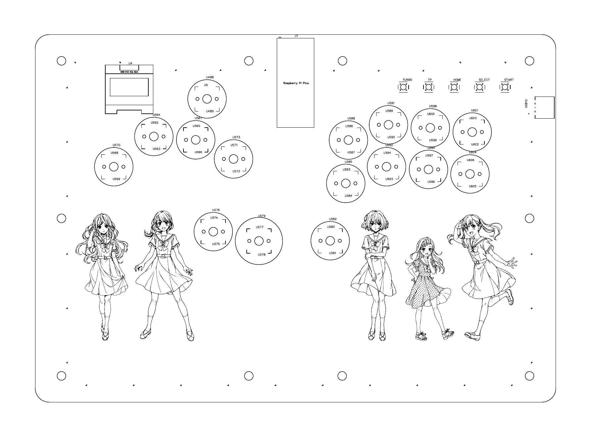

# 16 键沉头铆钉 Hitbox

**一款基于 Raspberry Pi Pico（RP2040）的自制 16 键无摇杆格斗控制器。**

- **按键布局：** 采用双跳布局，并配有投技、迸发等可自定义按键。
- **外壳结构：** 多层亚克力外壳采用隐藏式沉头铆钉结构，使铆钉表面与面板齐平。
- **RGB 灯光：** 按键下方和 PCB 板边设计有 RGB 反贴灯。
- **项目资料：** 提供嘉立创 PCB 工程及 Gerber、亚克力切割图与 3D 结构模型，并附材料成本和调试记录，供非商业学习与复刻参考。
- **本项目文件由 AI 协助整理，可能存在遗漏或错误，请在使用、加工或制作前自行审核并核对相关内容。**

## 按键布局

## 文件结构

| 位置 | 内容 |
| --- | --- |
| [`电路板/01_PCB工程_嘉立创EDA/`](电路板/01_PCB工程_嘉立创EDA/) | 原始嘉立创 EDA PCB 工程。 |
| [`电路板/02_Gerber制造文件/`](电路板/02_Gerber制造文件/) | Gerber 压缩包。 |
| [`电路板/03_PCB布局预览_PDF/`](电路板/03_PCB布局预览_PDF/) | PCB 版图预览 PDF，并非电路原理图。 |
| [`亚克力外壳/01_切割图_DWG_DXF/`](亚克力外壳/01_切割图_DWG/) | 二维切割图；发光板 DWG 参考图。 |
| [`亚克力外壳/02_3D结构模型_DWG/`](亚克力外壳/02_3D结构模型_DWG/) | 用于理解层叠结构的 3D 模型。 |
| [`亚克力外壳/加工说明.md`](亚克力外壳/加工说明.md) | 面向亚克力加工厂的厚度、喷绘与开孔要求。 |
| [`说明文档/`](说明文档/) | 材料成本、Pico 引脚与调试、开源协议说明。 |

## 设计概况

- 主控为 Raspberry Pi Pico；PCB 配置 16 个 CHOC 热插拔轴座、64 颗 3528 反贴 RGB 灯、5 个轻触开关、OLED 与 USB-A 接口。
- 两个跳键分别连至 `GP2/W` 与 `GP15/W2`；在 GP2040-CE 中可映射为同一个逻辑“上”。
- 外壳为多层亚克力结构。实际制作前请先用少量材料试装，确认轴、键帽、铆钉与板材公差。
- 详细的 GPIO、USB 22 Ω / 0805 电阻、双跳与 RGB 灯光错位排查见 [`说明文档/引脚与调试.md`](说明文档/引脚与调试.md)。

## 复刻提示

加工、焊接或修改电路前，请自行核验网络、尺寸与电气连接。

费用、采购规格和单价参考见 [`说明文档/材料与成本.md`](说明文档/材料与成本.md)。所有金额均为人民币的历史采购记录，不代表实时价格或单台成本。

## 固件与致谢

本项目使用 [OpenStickCommunity / GP2040-CE](https://github.com/OpenStickCommunity/GP2040-CE) 提供的开源手柄固件及其[官方文档](https://gp2040-ce.info/)。感谢该项目的维护者和所有贡献者。固件请从官方项目获取，本仓库不附带其源码。

诚挚感谢 B 站 UP 主 [LOVESONGCCC](https://space.bilibili.com/364015756)、[末日料理师](https://space.bilibili.com/14433725)、[H2xin](https://space.bilibili.com/13518665) 与 [-久寿川](https://space.bilibili.com/1368552)。他们分享的公开教程为本项目提供了许多实用的思路与帮助。

## 使用许可

本项目中作者有权授权的 PCB、外壳设计文件及说明文档采用 **[CC BY-NC 4.0（署名—非商业性使用 4.0 国际许可协议）](https://creativecommons.org/licenses/by-nc/4.0/deed.zh-hans)**。非商业使用、修改和分享时请遵守署名等协议条件；商业使用需要另行获得权利人的许可。第三方素材与 GP2040-CE 不在此授权范围内，详见 [`说明文档/开源协议说明.md`](说明文档/开源协议说明.md)。
